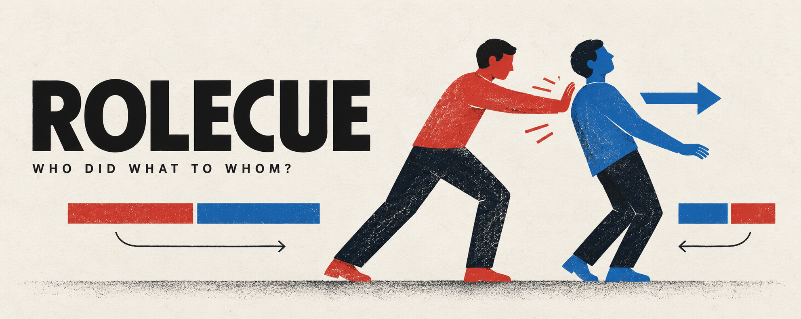

# ROLECUE

**Diagnosing cross-lingual role-binding failures in vision-language models**

Niaz Mohaiman Abtahi and Evan Maksud | WACV 2027, Evaluations and Datasets Track

A vision-language model may recognize who is acting in an image and correctly parse a sentence, yet struggle to decide whether the two agree. ROLECUE studies that gap with controlled images and sentences that change who acts, who is acted on, and which person is mentioned first.



## The benchmark

ROLECUE-192 contains **192 generated images**, **12 actions**, and sentences in **German, Japanese, Turkish, English, Korean, and Bangla**. Each scene shows two color-marked participants. Sentences appear in agent-first and patient-first orders, and answer options are reversed to help control for A/B label preference.

The evaluation separates three questions:

1. **Image only:** who performs the action in the image?
2. **Text only:** who performs the action according to the sentence?
3. **Joint:** does the sentence describe the roles in the image?

An external modular comparison combines the model's image-only and text-only predictions. This is a diagnostic constructed from those predictions, rather than a separate model call. The paper also examines response bias and cases where models tend to accept both matching and mismatching sentences.

## Dataset

The full-resolution images, manifests, and language templates are being prepared for release on Hugging Face under CC BY 4.0. A link will be added here once available. The manifests use paths relative to the dataset root; scripts expecting the original layout look for images under `data/processed/rolecue/`.

## Reproduce the camera-ready analyses

With Python 3.10 or later:

```bash
python -m venv .venv
# Activate the virtual environment, then:
python -m pip install numpy
python camera_ready_analysis/analyze_review_results.py
```

The script reads the archived multilingual model outputs and writes three files in `camera_ready_analysis/`:

- `common_no_chasing.csv`: agent-first and patient-first joint accuracy on the common 176-image subset.
- `acceptance_bias_heldout.csv`: exploratory leave-one-action-out threshold calibration. The calibration uses labeled training data and is not the original zero-shot score.
- `scoring_diagnostics.csv`: generated-answer parsing and answer-map consistency diagnostics.

These files were reproduced byte-for-byte in a fresh Python environment. Other archived scripts were developed in the original research workspace; some expect its directory layout or additional dependencies and have not yet been independently checked in a clean environment.

## Repository

| Path | Contents |
| --- | --- |
| `src/rolecue/` | Core dataset and scoring utilities |
| `scripts/` | Experiment, analysis, and table-building scripts from the review artifact |
| `prompts/` | Image-only, text-only, joint, and mitigation prompts |
| `results/` | Archived model outputs and summaries |
| `camera_ready_analysis/` | Additional analysis script and results |

## Scope and limitations

The images are synthetic, color-coded scenes of male-presenting adults, not a representative sample of real-world interactions. Static images make some actions, particularly chasing, ambiguous; the paper explains the image-only gate and no-chasing comparisons. Instructions were in English across language conditions, and few-shot prompting was not evaluated. Response bias can contribute to observed component-joint gaps, so these gaps do not identify a unique internal mechanism.

## License

Code is available under the [MIT License](LICENSE). The dataset is intended for release under CC BY 4.0.
